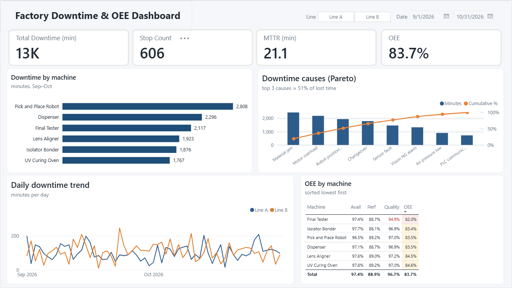

# Factory Downtime Analysis — SQL + Power BI

Analysis of machine downtime and OEE for a two-line assembly area, built with **SQL (SQLite)** and visualized in **Power BI**.
The goal is the same question a maintenance team asks every week: *which machine and which cause are costing us the most time, and where should we focus improvement?*

> Data is synthetic (2 months, 6 machines, ~600 downtime events) and was generated to resemble a real production log.

## Key questions
1. Which machine has the most downtime?
2. Which causes make up 80% of the lost time (Pareto)?
3. Does downtime differ between Day and Night shift?
4. What are the MTBF and MTTR of each machine?
5. What is the OEE (Availability × Performance × Quality) of each machine?

## Data model

```
            machine
          (1)    (1)
           |      |
          (*)    (*)
 downtime_log    production_log
          (*)    (*)
           |      |
          (1)    (1)
            Calendar
```

| Table | Description |
|---|---|
| `machine` | Machine ID, name, line, ideal units per hour |
| `downtime_log` | Each stop: machine, start time, minutes, cause, category, shift |
| `production_log` | Daily planned minutes, good and NG quantity per machine |
| `Calendar` | One row per date, Sep 1 – Oct 31, 2026 (created in Power BI) |

Calendar table links both fact tables so date filters stay consistent (star schema).

## Project structure

```
factory-downtime-analysis/
├── sql/
│   ├── 01_schema.sql            # create tables
│   ├── 02_seed_data.sql         # sample data
│   └── 03_analysis_queries.sql  # 7 analysis queries
├── data/                        # same data as CSV (for Power BI)
├── database/factory.db          # ready-to-use SQLite database
├── powerbi/
│   └── DAX_measures.md          # measures used in the dashboard
└── images/                      # dashboard screenshots
```

## SQL skills shown
`JOIN` / `LEFT JOIN` · `GROUP BY` / `HAVING` · aggregate functions · CTE (`WITH`) · window functions (`SUM() OVER`) for Pareto cumulative % · subqueries

## Key findings
- **Pick and Place Robot (M05)** has the most downtime (~2,800 min) and the most stops. Its main cause is *Robot position error*: frequent but short stops, over a third of its lost time.
- The top 3 causes (**Material jam, Motor overload, Robot position error**) make up ~51% of all downtime.
- **Night shift** loses more time than Day shift in both Mechanical and Electrical categories.
- **Final Tester (M06)** has the lowest OEE (82.0%), driven by Quality (94.9%), not by machine stops.
- No machine reaches world-class OEE (85%). Overall OEE is 83.7%, and **Performance (88.9%)** is the biggest loss.

**Recommended focus:** FCA on M05 robot position errors (teach points, gripper, encoder), and NG analysis at M06 Final Tester.

## Dashboard


## How to run
1. Install [DB Browser for SQLite](https://sqlitebrowser.org/) (free).
2. Open `database/factory.db` — or create a new database and run `01_schema.sql` then `02_seed_data.sql`.
3. Run queries in `03_analysis_queries.sql` from the **Execute SQL** tab.
4. Power BI: **Get Data → Text/CSV**, load the three files in `data/`, then follow `powerbi/DAX_measures.md`.

## Tools
SQLite · DB Browser for SQLite · Power BI Desktop · Git / GitHub
